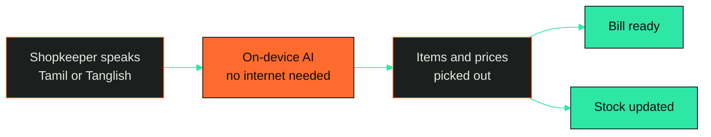
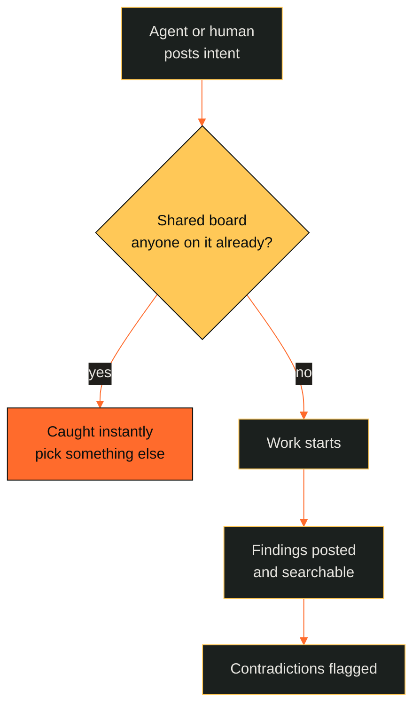
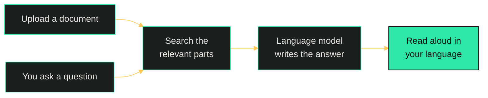
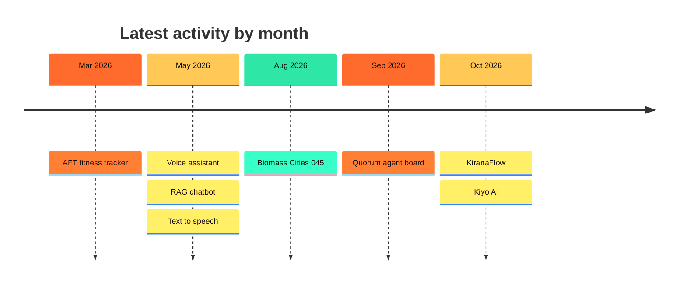

<div align="center">


<a href="https://github.com/bowsii">
  
</a>

<br/>

[](#about)
[](#projects)
[](#how-it-works)
[](#toolkit)
[](#stats)
[](#contact)

<br/>


</div>

<a id="about"></a>


<table>
<tr>
<td width="200" align="center" valign="top">

<br/><br/>
<code>he/him</code><br/>
<code>Coimbatore, India</code>
</td>
<td valign="top">

```yaml
name:      Bowsickdharan
studying:  B.Tech Artificial Intelligence & Machine Learning
college:   Sri Shakthi Institute of Engineering and Technology
year:      3rd
cgpa:      8.16
guild:     Studio Hexraei
focus:
  - Generative AI and RAG
  - Agents and multi-agent systems
  - Computer vision and NLP
  - Voice and local-language apps
goal:      production-ready AI apps, not demos
```

</td>
</tr>
</table>

> *"Technology becomes meaningful when it transforms ideas into solutions that create real-world impact."*

Right now I am building a document Q&A app that talks back in several languages, a voice-controlled billing app for small shops, and a shared board where AI agents coordinate with a person.


<a id="projects"></a>


<div align="center">

<a href="https://github.com/bowsii/Kirana-Flow"></a>
<a href="https://github.com/bowsii/Quorum-Moss-x-Zero-Latency"></a>

<a href="https://github.com/bowsii/BIOMASS-CITIES-045"></a>
<a href="https://github.com/bowsii/RAG"></a>


*Kiyo AI answers questions from your documents and reads the answer back in a language and voice you choose.*

</div>


<a id="how-it-works"></a>


<details open>
<summary><b>KiranaFlow</b>: say the bill, get the bill</summary>



</details>

<details>
<summary><b>Quorum</b>: agents that do not repeat each other's work</summary>



</details>

<details>
<summary><b>Kiyo AI</b>: ask your documents, hear the answer</summary>



</details>


<a id="build-log"></a>





<a id="toolkit"></a>


<div align="center">


<br/>


<br/>


</div>


<details>
<summary><b>Open the shelf (8 smaller repos)</b></summary>

<br/>

| Project | What it does |
| :-- | :-- |
| [Voice-Assistant](https://github.com/bowsii/Voice-Assistant) | Recognises your voice, listens to commands and acts on them |
| [AFT](https://github.com/bowsii/AFT) | Fitness tracker that gives feedback on your workout |
| [CI-CD_learning](https://github.com/bowsii/CI-CD_learning) | A hands-on walkthrough of how a CI/CD pipeline works |
| [Habit-Tracker-Console](https://github.com/bowsii/Habit-Tracker-Console) | Console habit tracker built to practise OOP |
| [leetcode](https://github.com/bowsii/leetcode) | My problem-solving log |
| [Text-to-Speech](https://github.com/bowsii/Text-to-Speech) | Text to speech experiments |
| [OOPS](https://github.com/bowsii/OOPS) | Notes and code on core OOP concepts |

</details>


<a id="stats"></a>


<div align="center">


</div>


- [ ] Ship Kiyo AI with better voice and a public demo
- [ ] Get stronger at retrieval, agents and computer vision
- [ ] Make voice and local-language support normal in everything I build
- [x] Build and ship KiranaFlow for real shops

<a id="contact"></a>
<div align="center">


<br/>

[](https://github.com/bowsii)
[](https://github.com/studio-hexraei)


</div>
